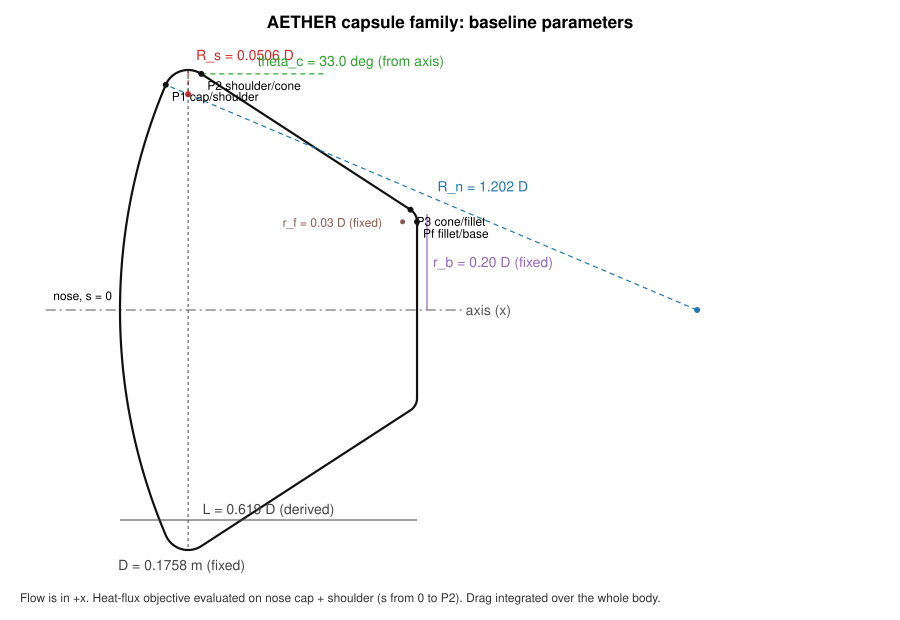

# Capsule geometry definition

*Project AETHER — geometry frozen 5 June 2026 (fillet added 16 June 2026, see logbook).*

## Coordinate system and fixed quantities

The capsule is axisymmetric. The meridional profile is defined in the (x, y) half-plane with x along the axis of symmetry, positive aft (the free stream travels in +x), and y the radial coordinate (y ≥ 0). The nose stagnation point is the origin.

| Fixed quantity | Symbol | Value | Reason |
|---|---|---|---|
| Maximum diameter | D | 0.17577 m (6.92 in) | 0.045-scale Apollo CM model of NASA TM X-1243; sets the Reynolds number of the benchmark |
| Reference area | A_ref = πD²/4 | 0.024266 m² | same for every candidate, so C_D ranks drag force directly |
| Nominal mass | m | 5.0 kg | bookkeeping only, for D_drag/m; does not enter the flow solution |
| Rear closure radius | r_b | 0.20 D = 0.03515 m | flat base disk closing the cone |
| Corner fillet radius | r_f | 0.03 D = 0.00527 m | rounds the cone/base corner (see "Why the fillet") |

## Design variables

| Variable | Symbol | Baseline | Sweep range | Geometric meaning |
|---|---|---|---|---|
| Nose radius ratio | R_n/D | 1.2023 (8.32 in / 6.92 in) | 0.60 – 1.60 | radius of curvature of the spherical nose cap; larger = flatter nose |
| Shoulder radius ratio | R_s/D | 0.0506 (0.35 in / 6.92 in) | 0.030 – 0.180 | radius of the toroidal transition from cap to cone |
| Rear-body cone half-angle | θ_c | 33.0° | 25° – 41° | angle between the straight cone generator and the axis |

The baseline values are the clean Apollo command module (AEDC 0.045-scale model, TM X-1243 Fig. 1b), which is also the validation geometry.

## Construction (all joins tangent-continuous)

1. **Nose cap.** Circle of radius R_n centred at (R_n, 0). A point at polar angle φ from the −x direction is (R_n − R_n cos φ, R_n sin φ).
2. **Shoulder.** Circle of radius R_s internally tangent to the cap and reaching the maximum radius D/2 at its top. Tangency angle: sin φ₁ = (D/2 − R_s)/(R_n − R_s). Shoulder centre C_s = (R_n − (R_n − R_s) cos φ₁, (R_n − R_s) sin φ₁); cap/shoulder join P₁ at angle φ₁ on the cap; maximum radius at the top of the shoulder circle.
3. **Cone.** Straight generator leaving the shoulder tangentially where the shoulder normal makes angle θ_c with the axis: P₂ = C_s + R_s (sin θ_c, cos θ_c), direction (cos θ_c, −sin θ_c).
4. **Closure.** The cone is cut by the base plane at the radius r_b: virtual corner x_b = x₂ + (y₂ − r_b)/tan θ_c. A fillet of radius r_f, tangent to the cone and to the base plane, replaces the sharp corner: centre C_f = (x_b − r_f, y_f) with n_c·(C_f − P₂) = −r_f, n_c = (sin θ_c, cos θ_c); cone/fillet join P₃ = C_f + r_f n_c; fillet/base join P_f = (x_b, y_f).
5. **Base.** Flat disk from P_f to the axis at (x_b, 0).

The total length L = x_b and the enclosed volume are therefore outputs of the closure rule, not inputs.

### Baseline values produced by the construction

| Quantity | Value |
|---|---|
| φ₁ | 22.97° |
| P₁ (cap/shoulder) | (0.01675, 0.08246) m, arc length s/R = 0.964 |
| Maximum radius | at s/R = 1.082 |
| P₂ (shoulder/cone) | (0.02978, 0.08645) m, s/R = 1.141 |
| P₃ (cone/fillet) | (0.10637, 0.03671) m |
| P_f (fillet/base) | (0.10877, 0.03229) m |
| Length L | 0.10877 m = 0.619 D |
| Volume | 1.4611 × 10⁻³ m³ = 0.269 D³ |
| Wetted area | 0.0704 m² |

TM X-1243 states the cap/toroid tangency at S/R = 0.965 and the maximum radius at S/R = 1.08 for its model; the construction reproduces both (0.964 and 1.082), which is the check that the scripted profile is the benchmark geometry. The report's aft cap (0.41 in radius apex) and sting are not modelled; the project's closure is the filleted flat base.

## Validity rules (shapes failing any rule are rejected and recorded)

- R_s < R_n and R_s < D/2 (shoulder smaller than the nose and than the body).
- (D/2 − R_s)/(R_n − R_s) ≤ 1: the shoulder fits; this is what excludes nose radii below about D/2.
- 0° < θ_c < 90°.
- The shoulder/cone join lies above the closure radius and the fillet fits between the join and the axis.
- Sampled profile: no negative radius, x monotone along the body (no fold-over), every join tangent-continuous (turning angle below the arc discretisation).
- Mesh generated from the profile has no inverted cell.

## Surfaces used for the two objectives

- **Drag:** pressure and viscous forces integrated over the whole modelled body (nose cap, shoulder, cone and fillet). In the production runs the computational domain ends at the cone end with an outlet plane normal to the cone (docs/mesh.md); the base disk is not in the domain. The base pressure force is bounded analytically: p_base between 0 and p∞ gives ΔC_D ≤ (2/γM²)(r_b/R)² = 0.0006 at M = 10.18, below the mesh uncertainty of C_D.
- **Peak heat flux:** maximum of the wall heat flux over the *heat-shield surface*, defined as the nose cap plus the shoulder up to the shoulder/cone tangency P₂ (s ≤ s_P₂). The same definition is applied to every candidate.

## Why the fillet

Test runs with a sharp cone/base corner (logbook, 15 June 2026) expanded the flow around the corner to pressures of order 10⁻³ p∞ and temperatures below 1 K — outside the perfect-gas, continuum model and a persistent source of non-physical points in the solver. Real capsule corners are machined with a radius; a fillet of 0.03 D (5.3 mm on the model) bounds the expansion and raises the minimum mesh angle from 17° to 39°. It is part of the fixed closure and identical for every candidate.

## Recreating the sketch in Onshape

The scripted profile is the geometry that is meshed and simulated. The Onshape model is the design-inspection twin; it must be built from the same definition:

1. Sketch on the XY plane; construction line along X (axis of symmetry).
2. Point N at the origin (nose). Circle arc "cap" centred on the axis at (R_n, 0) through N.
3. Circle "shoulder" of radius R_s: tangent constraint to the cap, and its top point constrained to y = D/2 (dimension from the axis). Trim at the tangency.
4. Line "cone" tangent to the shoulder with an angle dimension θ_c to the axis construction line.
5. Vertical line "base" at the (derived) position where the cone reaches y = r_b; fillet of r_f between cone and base (sketch fillet tool).
6. Revolve the closed region (profile + axis) 360° about X for the 3-D inspection model.
7. Export the sketch as DXF; compare with `profile.csv` of the corresponding case directory using `python -m aether geometry` (baseline) — the point-wise distance must be below 0.01 mm.

Parameter table for Onshape variables: `D = 175.77 mm`, `Rn = #Rn_D * D`, `Rs = #Rs_D * D`, `theta_c`, `rb = 0.20 * D`, `rf = 0.03 * D`.
