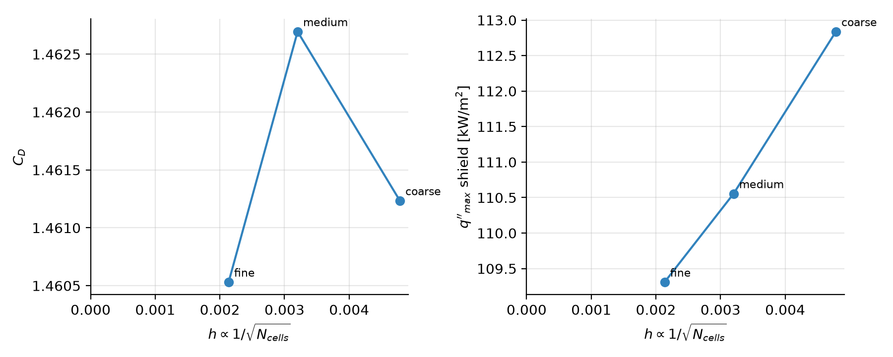
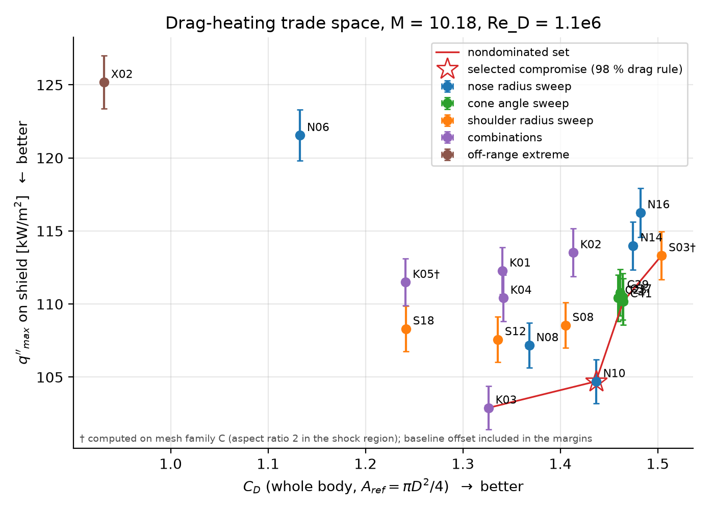
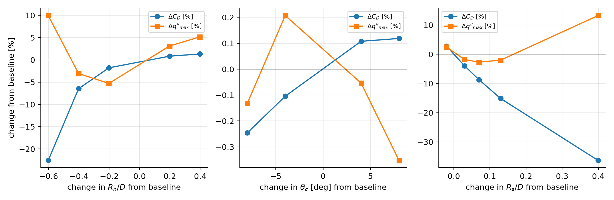
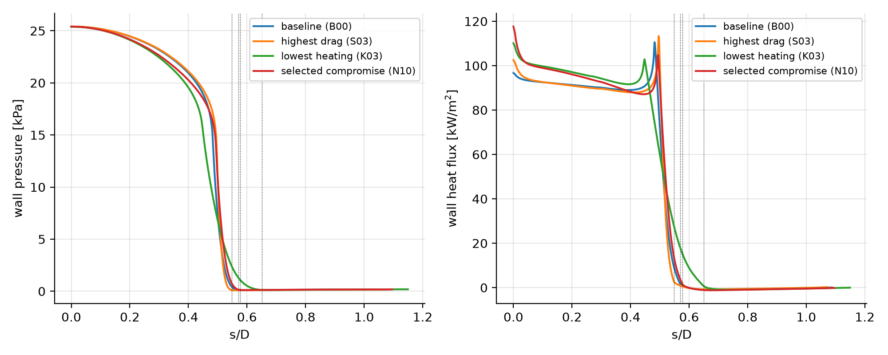
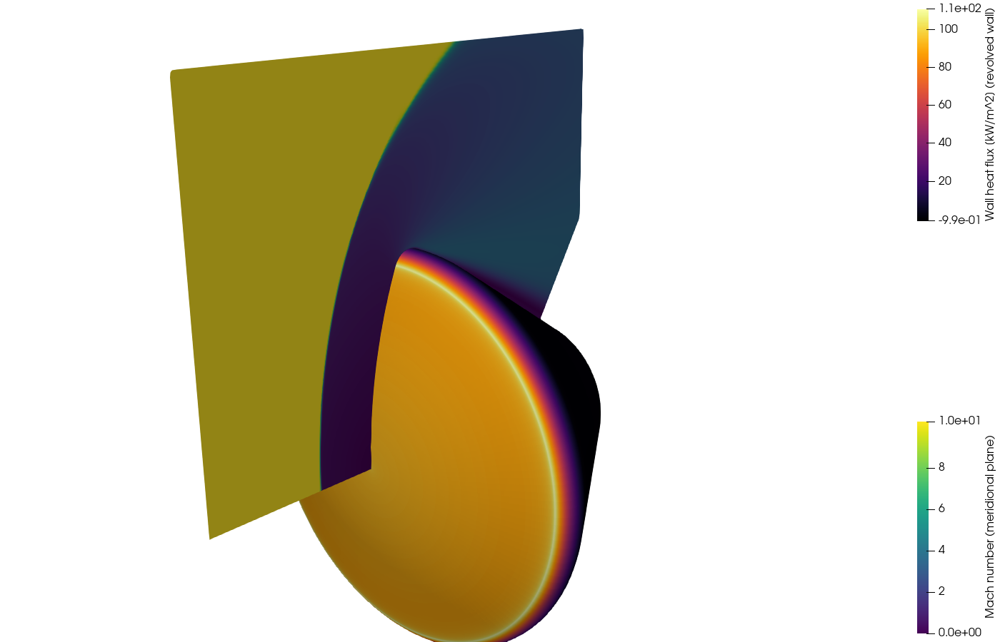

# Introduction

A blunt capsule entering the atmosphere must produce enough aerodynamic drag to decelerate while limiting the convective heating of its heat shield. Both quantities are set by the external shape at a given flight condition, and they do not have to move together: a flatter nose raises drag and spreads the heating over a larger surface, while the shoulder that joins the face to the afterbody concentrates heating where the boundary layer is thinnest. This study asks a bounded version of that question:

> How do nose radius, shoulder radius and rear-body cone half-angle affect the drag coefficient and the peak surface heat flux of an Apollo-like axisymmetric capsule at one fixed hypersonic condition?

The study keeps the maximum diameter, the reference area and the free-stream condition fixed, varies the three shape parameters one at a time and then in combination, computes drag and wall heat flux with laminar compressible Navier–Stokes simulations, and reports the nondominated set of shapes with the numerical uncertainty needed to say whether two shapes actually differ. Heat-shield thickness, ablation, trajectory integration and high-temperature chemistry are outside the scope.

# Method

## Condition and reference data

The simulations reproduce the clean Apollo command module test of NASA TM X-1243 (Bertin, 1966) at zero angle of attack in AEDC Tunnel C: Mach 10.18, Reynolds number 1.1 × 10^6^ based on the model diameter D = 0.1758 m, laminar flow. The report gives the measured pressure (p/p_t vs S/R) and heating (q/q_t vs S/R) distributions over the heat shield and the model geometry, which is also the baseline shape of the study. Because the run's stagnation temperature is not quoted, T~0~ = 1056 K (1900 °R) is taken from the facility envelope and the wall is a 300 K cold wall; the derived free stream is in `docs/conditions.md`. A second, planar benchmark — Run 31 of NASA TM 100484 (Wieting, 1987), a 3-inch cylinder at Mach 8.03 with tabulated surface pressure and heat flux — is used to check the solver's wall heat-flux prediction independently of the axisymmetric treatment.

The gas is calorically perfect air with Sutherland viscosity and a constant laminar Prandtl number of 0.72. At the main condition the post-shock temperature reaches 1056 K, where vibrational excitation changes the specific heats by a few percent and dissociation is negligible; at the cylinder condition it reaches 1736 K (perfect gas) against the 1583 K of the thermally perfect tunnel calibration. These are stated limitations of the heating comparison, not of the ranking between shapes at the same condition.

## Geometry

The capsule profile (`docs/geometry.md`) is a spherical nose cap of radius R_n, a toroidal shoulder of radius R_s reaching the fixed maximum radius D/2, a straight cone at half-angle θ_c, and a fixed closure (base radius 0.20 D with a 0.03 D corner fillet). All joins are tangent-continuous, the total length follows from the closure rule, and shapes failing the validity rules (shoulder that does not fit, fillet that does not fit, fold-over) are rejected and recorded. The baseline (R_n/D = 1.202, R_s/D = 0.0506, θ_c = 33°) reproduces the tangency and maximum-radius landmarks quoted in the reference report to within 0.002 in S/R.

## Mesh and solver

Body-fitted structured meshes are generated from the same parameter table (`docs/mesh.md`): wall-orthogonal boundary-layer cells (first cell 2 µm and growth 1.10 at the sweep level), uniform cells through the shock region (0.53 mm across the shock, 0.8 mm along it), a smooth far boundary at 2 D ahead of the nose, and an outlet plane normal to the cone at its end. The base and near wake are excluded: at Mach 10 the base pressure force is bounded by ΔC_D ≤ 0.0006, below the mesh uncertainty, while the laminar near wake is unsteady and in test runs fed a limit cycle into the whole field. Three nested levels (every spacing ÷ 1.5 per level; 43 680, 97 500 and 219 375 cells for the baseline) support a Richardson extrapolation of the baseline results; the sweep is run at the medium level. A first mesh family with isotropic cells in the shock region was abandoned after the sweep because eight of the eighteen shapes converged, from any start, to the carbuncle branch of the first-order scheme on it; elongating the cells along the shock (the production family) removed the problem for all but one shape, and the fourteen cases converged on both families agree to 0.05 % in drag and 0.8 % in peak heating (`docs/validation.md` A.6, `results/tables.md`).

The flow solver is SU2 v8.5.0 built from source with one source patch: the near-axis treatment of the axisymmetric source terms proposed in SU2 pull request #2715. Without it, SU2's axisymmetric mode produces an unphysical heating dip at the stagnation line (a sphere test on the validated cylinder mesh drops from 504 to 154 kW/m² at the second wall node against a 640–705 plateau), a defect also reported in SU2 issues #1373 and #2438; with the patch the profile is monotone and the residual converges to 10^-9^. Each case is run in stages on the same mesh: a Roe start-up with a large entropy fix (carbuncle-free, converges strongly, but with an unusable boundary-layer heat flux), then SLAU2 first order restarted from it, which converges to the physical, carbuncle-free branch at every level. Second-order reconstruction is used only for the planar benchmark, because in axisymmetric mode it never reaches a stationary state with this SU2 version whatever the flux, limiter or CFL (`docs/validation.md` A.4); the first-order discretisation error is quantified by the mesh study and by the first/second-order comparison on the cylinder.

Wall heat flux and pressure are read at the wall nodes of the volume solution and cross-checked against the first-cell temperature gradient (within 3 %). A case counts as converged when SU2's Cauchy criterion on drag and heat flux stops it or the iteration limit is reached, the post-processor finds drag flat to 0.2 % over the last 500 iterations with the density residual down by at least one order and the peak heat flux changed by less than 3 % between the last two solution snapshots (the observed changes, at most 0.4 %, enter the uncertainty), and the solution passes a physical-branch check: stagnation pressure within 3 % of the Rayleigh pitot value and no heating spike on the axis. Solutions failing the branch check are retried with gentler schedules, but a solution reached only through a low-CFL retry is reported and not ranked, because such runs turned out to be slow transients rather than steady states (`docs/validation.md` A.5).

## Objectives, sweep and selection rule

The objectives are the whole-body drag coefficient (reference area πD²/4 for every shape) and the maximum wall heat flux over the heat-shield surface, defined as the nose cap plus the shoulder up to the shoulder/cone tangency. The sweep (`configs/sweep.yaml`) varies R_n/D over 0.6–1.6, θ_c over 25–41° and R_s/D over 0.03–0.18 one at a time about the baseline, adds five combinations, and includes two deliberately invalid shapes. The preferred compromise is selected by an explicit rule — the lowest peak heat flux among designs with C_D ≥ 0.98 C_D,baseline — and two alternative rules (0.95 and 1.00) are reported for sensitivity. Two designs are called different only if their objectives differ by more than the numerical uncertainty from the mesh study.

# Verification and validation

**Planar benchmark (Wieting cylinder, Mach 8.03).** On three nested polar meshes (23 380 to 117 180 cells) the stagnation pressure equals the Rayleigh pitot value to 0.1 % and the pressure distribution follows the measurements to within their scatter (rms 0.023 in p/P~0~ over 18 stations). The stagnation heat flux is 2–11 % above the perfect-gas Fay–Riddell value and 24–30 % below the measured Q~0~, the same gap the report itself notes between its data and viscous-shock-layer theory; the normalised heating distribution q''/q''_stag follows the measured q''/Q~0~ to an rms of 0.04–0.06 over 34 stations. First- and second-order solutions differ by at most 1.3 % in stagnation heating and 0.4 % in drag, which bounds the effect of using first order in the axisymmetric runs. The absolute heating level is therefore trusted to about 25 %, and the shape ranking relies on differences at the same condition (`docs/validation.md` A.1).

**Axisymmetric treatment.** A sphere computed on the validated cylinder mesh with `AXISYMMETRIC= YES` showed the unphysical stagnation-line heating dip of SU2's axisymmetric source terms (second wall node at 154 kW/m² against a 640–705 plateau); with the near-axis patch of pull request #2715 the profile is monotone and the residual converges to 10^-9^. First-order SLAU2 was selected after AUSM+-up2, Roe, HLLC and the second-order variants either produced a carbuncle at the stagnation line or never reached a stationary state in axisymmetric mode (`docs/validation.md` A.2–A.4).

**Apollo at α = 0 (Bertin, Mach 10.18).** On the three levels of the production family the stagnation pressure is within 1.1 %, 0.5 % and 0.3 % of the pitot value, the computed p/p_t2 over the cap follows the 14 measured stations to an rms of 0.05 (the largest differences, ±0.12, at the two stations on the toroid where the measured expansion starts slightly before the geometric tangency), the SU2 drag integration and an independent integration of the wall pressure and skin friction agree to 0.06 %, and modified Newtonian theory gives a forebody C_D of 1.59 against 1.46 computed (its known overestimate over the outer face). The computed heating is flat over the face (q''/q''_t between 0.97 and 1.04 for S/R ≤ 0.92) as measured, the plateau level is 8–11 % above the perfect-gas Fay–Riddell estimate for the baseline nose radius (the report notes measured stagnation velocity gradients 12 % above Newtonian), and the shock stands 0.152 D ahead of the nose. The one systematic difference is the shoulder: SU2 gives a sharp peak of 1.2 q''_t at the cap/toroid tangency where the thermocouples show 0.80–0.87, then both fall together; a thin-skin gauge cannot resolve a peak narrower than its lateral conduction length on a 0.35-inch toroid and Lees' theory applied to the measured pressures also peaks there, so the peak is treated as physical and its height as the quantity to be bounded by the mesh study (`docs/validation.md` B).

**Mesh convergence and domain.** For the baseline on the production family the peak heat flux converges monotonically (112.8, 110.6, 109.3 kW/m²) with an observed order of 1.5, an extrapolated value of 107.8 kW/m² and a medium-level GCI of 3.1 %; the face plateau converges with order 2.4 (GCI 1.6 %), the shock stand-off with order 0.9 (GCI 2.7 %), and the drag coefficient oscillates within 0.15 % (conservative GCI 0.6 %). Moving the far boundary from 2 D to 3 D ahead of the nose and from 4.5 D to 7 D downstream changes drag and peak heating by 0.01 % and 0.05 % respectively. The uncertainty of a design difference is measured separately by re-running the finalists at the fine level (Results).

# Results

## The sweep

Eighteen valid shapes were computed at the medium level of the production family, plus the two deliberately invalid shapes rejected by the validity rules (X01: nose radius too small for the shoulder; X03: shoulder radius larger than the maximum radius) and one off-range extreme (X02, R_s/D = 0.45, which the rules accept). Every ranked solution is on the physical branch, converged under the criteria of the Method, and was obtained at the first SLAU2 attempt on family B or, for the two shapes that stay on the carbuncle branch there (S03, K05), on family C. Table 1 lists the trade space; `results/tables.md` lists every case, every level and every family.

Table 1. Trade space at the sweep level (family B; † family C). Baseline B00: C_D = 1.4627, q''_max = 110.6 kW/m², peak at the cap/toroid tangency (S/R = 0.96), plateau 91.9 kW/m², stand-off 0.152 D.

| Case | R_n/D | R_s/D | θ_c [°] | C_D | ΔC_D | q''_max [kW/m²] | Δq''_max | peak at S/R | nondominated |
|---|---:|---:|---:|---:|---:|---:|---:|---:|---|
| N06 | 0.60 | 0.0506 | 33 | 1.1327 | −22.6 % | 121.5 | +9.9 % | 0.26 (face) | |
| N08 | 0.80 | 0.0506 | 33 | 1.3680 | −6.5 % | 107.2 | −3.1 % | 0.25 (face) | |
| N10 | 1.00 | 0.0506 | 33 | 1.4366 | −1.8 % | 104.7 | −5.3 % | 0.99 | yes |
| B00 | 1.20 | 0.0506 | 33 | 1.4627 | 0 | 110.6 | 0 | 0.96 | (margin) |
| N14 | 1.40 | 0.0506 | 33 | 1.4748 | +0.8 % | 114.0 | +3.1 % | 0.95 | |
| N16 | 1.60 | 0.0506 | 33 | 1.4821 | +1.3 % | 116.3 | +5.2 % | 0.95 | |
| C25 | 1.20 | 0.0506 | 25 | 1.4591 | −0.2 % | 110.4 | −0.1 % | 0.96 | |
| C29 | 1.20 | 0.0506 | 29 | 1.4612 | −0.1 % | 110.8 | +0.2 % | 0.96 | (margin) |
| C37 | 1.20 | 0.0506 | 37 | 1.4643 | +0.1 % | 110.5 | −0.1 % | 0.96 | (margin) |
| C41 | 1.20 | 0.0506 | 41 | 1.4644 | +0.1 % | 110.2 | −0.4 % | 0.96 | yes |
| S03† | 1.20 | 0.030 | 33 | 1.5039 | +2.8 % | 113.3 | +2.5 % | 0.99 | yes |
| S08 | 1.20 | 0.080 | 33 | 1.4052 | −3.9 % | 108.5 | −1.8 % | 0.92 | |
| S12 | 1.20 | 0.120 | 33 | 1.3358 | −8.7 % | 107.6 | −2.7 % | 0.86 | |
| S18 | 1.20 | 0.180 | 33 | 1.2414 | −15.1 % | 108.3 | −2.0 % | 0.77 | |
| K01 | 1.60 | 0.120 | 33 | 1.3405 | −8.4 % | 112.3 | +1.6 % | 0.83 | |
| K02 | 1.60 | 0.080 | 25 | 1.4132 | −3.4 % | 113.5 | +2.7 % | 0.90 | |
| K03 | 1.00 | 0.120 | 33 | 1.3262 | −9.3 % | 102.9 | −6.9 % | 0.90 | yes |
| K04 | 1.40 | 0.120 | 41 | 1.3414 | −8.3 % | 110.4 | −0.1 % | 0.85 | |
| K05† | 1.60 | 0.180 | 29 | 1.2412 | −15.1 % | 111.5 | +0.9 % | 0.73 | |
| X02 | 1.20 | 0.450 | 33 | 0.9315 | −36.3 % | 125.2 | +13.2 % | 0.25 (face) | |

## One-variable sensitivities

**Nose radius** is the drag lever: C_D rises from 1.13 at R_n/D = 0.6 to 1.48 at 1.6, steeply below the baseline and flattening above it (+0.8 % from 1.2 to 1.4, +0.5 % from 1.4 to 1.6), because the face pressure approaches the flat-disc limit. The peak heating has a minimum near R_n/D = 1.0: for the two smallest nose radii the peak is the stagnation-region plateau itself (120 and 106 kW/m² at R_n/D = 0.6 and 0.8, where the shoulder peak is lower than the face), while for R_n/D ≥ 1.0 the peak is the shoulder, which grows from 105 to 116 kW/m² as the face flattens and the flow accelerates harder around the toroid, even though the plateau falls from 98 to 86 kW/m².

**Shoulder radius** trades drag for a flatter heating distribution: C_D falls almost linearly from 1.50 at R_s/D = 0.03 to 1.24 at 0.18 (−1.2 C_D per unit R_s/D), because the toroid replaces part of the high-pressure face; the shoulder peak moves inward (S/R from 0.99 to 0.77) and falls by 4 % from 0.03 to 0.12, then rises again as the toroid takes over the face (X02: 0.93 and 125 kW/m², the peak back on the axis).

**Cone half-angle** changes nothing measurable at this condition: 25° to 41° moves C_D by 0.4 % and the peak heating by 0.4 %, both within the ranking margins, because the afterbody pressure is about 1 % of the stagnation pressure and the forebody is unchanged (the shoulder expansion sets the cone pressure, not the cone angle).

**Combinations** behave as the sum of their parts: K03 (R_n/D = 1.0 with R_s/D = 0.12) reaches the lowest peak heating of the study, 102.9 kW/m² (−6.9 %), at a drag cost of 9.3 %; the large-nose combinations (K01, K02, K05) lose the drag of their large shoulders without gaining in heating, because their shoulder peaks stay high.

## Nondominated set, selection and ranking stability

The nondominated set of the computed points is {S03, C41, N10, K03}, in order of decreasing drag: the sharpest shoulder for maximum drag (+2.8 % C_D, +2.5 % heating), the baseline family at 41° (+0.1 %, −0.4 %), the smaller nose radius (−1.8 %, −5.3 %) and its combination with a larger shoulder (−9.3 %, −6.9 %). With the ranking margins (0.24 % in C_D and 1.4 % in peak heating) the baseline, C29 and C37 cannot be separated from C41, so the cone-angle family is one point of the set.

The selection rule "lowest peak heat flux among designs with C_D ≥ 0.98 C_D,baseline" selects **N10** (R_n/D = 1.0): −5.3 % peak heating for −1.8 % drag. The 0.95 rule selects N10 as well (K03, at 0.907 C_D,baseline, is excluded by both), and the 1.00 rule selects C41, whose gains are within the margins, i.e. at baseline drag no shape of the sweep lowers the peak heating measurably. The highest-drag shape (S03) and the lowest-heating shape (K03) are the ends of the set.

Fine-level re-runs of the finalists (Table 2) leave the ranking unchanged: the ratio of each finalist's objectives to the baseline moves by at most 0.24 % in drag and 1.4 % in peak heating between the medium and the fine level, the latter for the sharp shoulder of S03 whose peak is the least converged quantity of the study; N10's heating ratio is identical at both levels.

Table 2. Finalists at the fine level (ratios to the baseline at the same level and family).

| Case | C_D medium → fine | q''_max medium → fine [kW/m²] | C_D / C_D,B00 medium → fine | q''_max ratio medium → fine |
|---|---:|---:|---:|---:|
| N10 | 1.4366 → 1.4380 | 104.7 → 103.5 | 0.982 → 0.985 | 0.947 → 0.947 |
| C41 | 1.4644 → 1.4626 | 110.2 → 109.4 | 1.001 → 1.001 | 0.996 → 1.000 |
| S03 (family C) | 1.5039 → 1.5044 | 113.3 → 110.9 | 1.028 → 1.030 | 1.029 → 1.015 |
| K03 | 1.3262 → 1.3274 | 102.9 → 102.1 | 0.907 → 0.909 | 0.931 → 0.934 |

## Fields

Figure files: `results/figures/pareto.png` (trade space with the margins as error bars), `sensitivities.png`, `wall_distributions.png` (wall pressure and heat flux of the baseline, S03, K03 and N10), `fields/*` (Mach, temperature, pressure and numerical schlieren in the meridional plane for the same four shapes, and a revolved view of the baseline for visualisation only). The wall distributions show the mechanism directly: the face pressure of all four shapes is the same within 2 % out to S/R ≈ 0.8, the drag difference is made at the shoulder, where the pressure of the small-shoulder shapes stays high over a longer arc; the heat flux is flat over the face at a level set by the nose radius (92 kW/m² for R_n/D = 1.2, 98 for 1.0) and the peak at the tangency is sharper and higher the smaller the shoulder radius (S03 113, B00 111, K03 103 kW/m²). The shock stand-off follows the nose radius (0.085 D for R_n/D = 0.6, 0.152 D for 1.2, 0.173 D for 1.6) and is not changed by the shoulder.

# Discussion

**What the trade space says.** At this condition the two objectives are coupled through one mechanism: the heat-shield face carries nearly the pitot pressure whatever its curvature, so drag is set by how much of the maximum-diameter disc the high-pressure face covers (large nose radius, small shoulder radius), while the peak heating sits at the shoulder for every shape of the family with R_n/D ≥ 1 and grows with the strength of the expansion there, i.e. with the same two parameters. Lowering the peak therefore costs drag, and the sweep quantifies the exchange rate along the nondominated set: about 2 % of drag per 5 % of peak heating between the baseline and N10, then 7 % of drag per 1.6 % of heating between N10 and K03. A flatter, sharper-shouldered capsule (S03) buys 2.8 % more drag for 2.5 % more peak heating. The Apollo shape sits where the drag curve has already flattened (R_n/D above 1.2 adds less than 1 % per 0.2) and the heating curve is still rising, which is why the only designs that beat it in heating at nearly equal drag are those with a slightly smaller nose radius.

**Why the cone angle does not matter.** The afterbody pressure at Mach 10 is set by the expansion around the shoulder and is of the order of p∞, so the cone contributes 1–2 % of the drag and nothing to the shield heating; the angle changes the length of the capsule (L/D from 0.80 at 25° to 0.51 at 41°) and therefore volume and packaging, which is where the design choice actually lives.

**What the numbers are good for.** The absolute heating level is trusted to about 25 % (the gap between the perfect-gas computation and the shock-tunnel data in Benchmark A), and the absolute shoulder peak to a few percent more, because the thin-skin measurements of Benchmark B cannot confirm it. The *differences* between shapes are trusted to the ranking margins (0.24 % in drag, 1.4 % in peak heating), established by re-running the finalists at the fine level and by computing the baseline and ten of the shapes on two independent mesh families, which agree to 0.05 % in drag and 0.8 % in peak heating. The conclusions about which parameter moves which objective, and by how much relative to the baseline, are therefore robust; the conclusion about the absolute heating of any shape is not, and is not claimed.

**The numerical lesson.** Most of the effort of the study went into the first-order scheme's two steady branches. Three findings are worth recording for anyone repeating this with SU2: the axisymmetric source terms need the near-axis treatment of pull request #2715 to give a monotone stagnation heating; a solution that passes the convergence monitors can still be on the carbuncle branch or be a slow transient at low CFL, so a physical check (stagnation pressure against the pitot value, stagnation heating against the face plateau, plateau against the nose-radius scaling) belongs in every post-processing step; and the branch is a property of the mesh in the shock region, removed by cells elongated along the shock rather than by any start-up or CFL schedule.

# Limitations

- **Gas model and condition.** Calorically perfect air with Sutherland viscosity extrapolated to 49 K, laminar flow, one Mach number and Reynolds number at wind-tunnel scale, cold wall. The absolute heating level is trusted to about 25 % (Benchmark A) and the post-shock temperature reaches 1056 K; the study ranks shapes at one condition and does not predict flight heating.
- **Discretisation.** First-order convective fluxes in the axisymmetric runs, because no second-order configuration reached a stationary state in SU2's axisymmetric mode; the order effect is bounded by the cylinder benchmark (≤ 1.3 % in stagnation heating) and the discretisation error by the mesh study (3 % on the peak heating at the sweep level). The peak sits at the cap/toroid tangency, where the measured data do not resolve it.
- **Carbuncle branch.** The first-order scheme has a mesh-dependent carbuncle branch; it is detected by a physical check on every solution and was removed by elongating the shock-region cells (two shapes, S03 and K05, needed the stronger elongation of family C, whose baseline agrees with the production family to 0.4 %). The remedy is empirical: it works for every shape of this sweep, but a new shape must be checked the same way.
- **Geometry.** The flat closure with a fixed base radius replaces the Apollo aft cap and sting; the base and wake are excluded from the domain with the base force bounded analytically (ΔC_D ≤ 0.0006). The afterbody drag is therefore not benchmarked, the forebody pressure is.
- **Design space.** Three parameters varied one at a time plus five combinations; the nondominated set is that of the computed points, not of the continuous family, and the selection rule is a stated preference, not an optimisation.
- **Tools.** The Onshape model is a manual step reproduced by the author from the scripted profile (`docs/geometry.md`); every number in the report comes from the scripted geometry.

# Conclusions

1. For an Apollo-like capsule at Mach 10.18 and Re_D = 1.1 × 10^6^, nose radius and shoulder radius control both objectives through the fraction of the frontal disc covered by the high-pressure face; the cone half-angle (25–41°) changes drag and peak heating by less than 0.4 %.
2. Drag rises from C_D = 1.13 to 1.48 as R_n/D goes from 0.6 to 1.6 and falls from 1.50 to 1.24 as R_s/D goes from 0.03 to 0.18. The peak heating has a minimum near R_n/D = 1.0 (−5 % relative to the baseline) because below it the stagnation region takes over from the shoulder, and a shallow minimum near R_s/D = 0.12 (−3 %).
3. The nondominated set is S03 (R_s/D = 0.03: +2.8 % drag, +2.5 % heating), the baseline family (C41 within the margins of B00), N10 (R_n/D = 1.0: −1.8 % drag, −5.3 % heating) and K03 (R_n/D = 1.0 with R_s/D = 0.12: −9.3 % drag, −6.9 % heating). The stated rule (lowest peak heating at ≥ 98 % of the baseline drag) selects N10; the 95 % rule selects the same shape and the 100 % rule finds nothing that improves on the baseline beyond the margins.
4. The ranking is stable under mesh refinement (finalists at the fine level: ratios to the baseline change by ≤ 0.24 % in drag and ≤ 1.4 % in peak heating) and under a change of mesh family (≤ 0.05 % and ≤ 0.8 % on ten shapes).
5. The computed pressure distributions match the NASA Apollo data to an rms of 0.05 in p/p_t, the face heating is flat as measured, the planar cylinder benchmark reproduces the measured heating distribution shape to an rms of 0.04–0.06 with the absolute level 25 % low, consistent with the report's own comparison to theory. Absolute heating is therefore quoted with a 25 % uncertainty, shape differences with the ranking margins above.

# Reproducibility

Every number in this report is produced by `make all` from the repository (`README.md`): meshes, configurations, solver logs, convergence histories, wall profiles and summaries are kept per case under `cases/`, and `results/results.csv` lists every case including the failed and the rejected ones. Software versions are recorded in `docs/versions.md`; the solver patch is `tools/aether_su2_patches.diff`.

# References

1. Bertin, J. J., *The Effect of Protuberances, Cavities, and Angle of Attack on the Wind-Tunnel Pressure and Heat-Transfer Distribution for the Apollo Command Module*, NASA TM X-1243, 1966.
2. Wieting, A. R., *Experimental Study of Shock Wave Interference Heating on a Cylindrical Leading Edge*, NASA TM 100484, 1987.
3. Economon, T. D., Palacios, F., Copeland, S. R., Lukaczyk, T. W., Alonso, J. J., "SU2: An Open-Source Suite for Multiphysics Simulation and Design", *AIAA Journal* 54(3), 2016. SU2 v8.5.0, https://su2code.github.io.
4. Kitamura, K., Shima, E., "Towards shock-stable and accurate hypersonic heating computations: A new pressure flux for AUSM-family schemes", *J. Comput. Phys.* 245, 2013 (SLAU2).
5. Fay, J. A., Riddell, F. R., "Theory of Stagnation Point Heat Transfer in Dissociated Air", *J. Aeronaut. Sci.* 25(2), 1958.
6. Lees, L., "Laminar Heat Transfer over Blunt-Nosed Bodies at Hypersonic Flight Speeds", *Jet Propulsion* 26(4), 1956.
7. Celik, I. B., Ghia, U., Roache, P. J., Freitas, C. J., Coleman, H., Raad, P. E., "Procedure for Estimation and Reporting of Uncertainty Due to Discretization in CFD Applications", *J. Fluids Eng.* 130(7), 2008.
8. Anderson, J. D., *Hypersonic and High-Temperature Gas Dynamics*, 2nd ed., AIAA, 2006.
9. SU2 pull request #2715, "Axisymmetric near-axis fixes using L'Hôpital-consistent formulations", https://github.com/su2code/SU2/pull/2715; SU2 issues #1373 and #2438.
