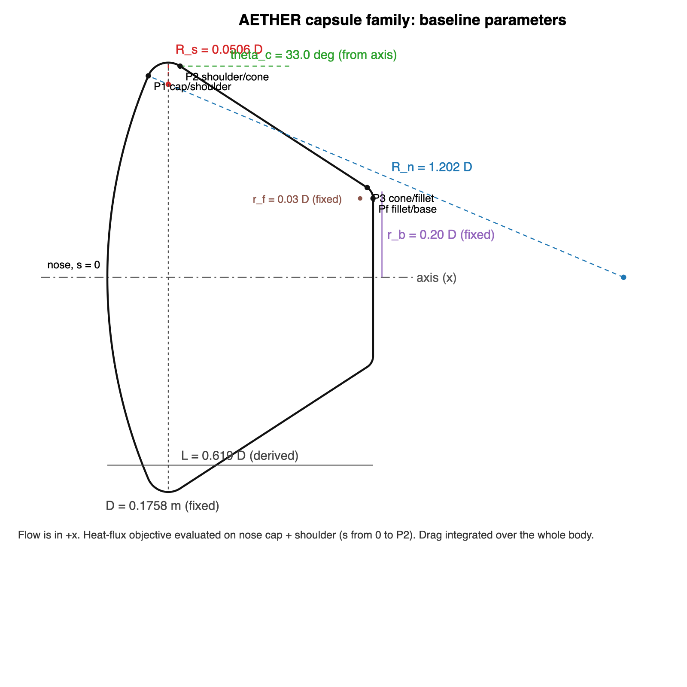

# The question

- A capsule needs drag to slow down and must survive the heating that comes with it.
- Three shape parameters: nose radius R_n/D, shoulder radius R_s/D, cone half-angle θ_c.
- One fixed condition: Mach 10.18, Re_D = 1.1 × 10^6^, cold wall (the Apollo Tunnel C test of NASA TM X-1243).
- Two objectives: maximise C_D, minimise the peak heat flux on the heat shield.

# From STEM F1 Racing to AETHER

- Same method: parameterise a shape, simulate, compare, decide, explain.
- New physics: a bow shock, a thin thermal boundary layer, drag that is now useful.
- New discipline: every number traced to a mesh, a configuration and a convergence check.

# Geometry family

{height=75%}

- Tangent joins; the aft length follows from the closure rule.
- Baseline = clean Apollo model: landmarks of the reference report reproduced to 0.002 in S/R.
- Invalid shapes (shoulder or fillet that does not fit) are rejected and recorded.

# Mesh and solver

- Body-fitted structured mesh built from the parameter table; three nested levels (÷1.5).
- SU2 v8.5.0, laminar Navier–Stokes, axisymmetric, isothermal wall.
- What I had to find out the hard way:
  - an axis defect in SU2's axisymmetric mode (patched, verified on a sphere);
  - the carbuncle instability and a two-branch solution — fixed by a Roe start-up and a SLAU2 restart;
  - second order never stationary in axisymmetric mode — first order plus a mesh study instead.

# Validation

{height=32%}

- Pressure: stagnation value = pitot to 0.1 % (cylinder) and 0.5 % (Apollo); distributions within the data scatter (rms 0.02 and 0.05).
- Heating shape: rms 0.04–0.06 against 34 cylinder stations; Apollo face flat as measured.
- Absolute heating level 25 % below the shock-tunnel data, same gap the report sees against theory → absolute level ±25 %, differences much better.

# Validation — Apollo at α = 0

{height=70%}

# Mesh convergence

{height=34%}

- Three nested levels (÷1.5): peak heating 112.8 → 110.6 → 109.3 kW/m², observed order 1.5, GCI 3.1 % at the sweep level; drag within 0.15 %.
- Far boundary moved out: 0.01 % in drag, 0.05 % in heating.
- Finalists re-run on the fine mesh: ratios to the baseline move ≤ 0.24 % (drag) and ≤ 1.4 % (heating) → these are the margins for "different".

# Trade space

{height=80%}

# Trade space: what it says

- Nondominated: S03 (sharp shoulder, +2.8 % C_D, +2.5 % q), baseline family, N10 (R_n/D = 1.0: −1.8 % C_D, −5.3 % q), K03 (R_n/D = 1.0 + R_s/D = 0.12: −9.3 %, −6.9 %).
- Rule "lowest heating at ≥ 98 % baseline drag" → N10. Same at 95 %. At 100 %: nothing beats the baseline beyond the margins.
- Twenty shapes, every one on the physical branch, every number traceable to its case directory.

# Sensitivities

{height=38%}

- Nose radius: drag 1.13 → 1.48 over R_n/D 0.6 → 1.6; heating minimum at R_n/D ≈ 1.0 (stagnation region takes over below it).
- Shoulder radius: −1.2 C_D per unit R_s/D; shallow heating minimum near 0.12; the peak moves inward.
- Cone angle: < 0.4 % on both objectives — it sets length and volume, not the aerothermal trade.

# What the flow looks like

{height=80%}

# What the wall sees

{height=45%}

- Face at ≈ pitot pressure for every shape; drag is decided at the shoulder.
- Heating flat on the face (level set by nose radius), sharp peak at the cap/toroid tangency, higher for smaller shoulders.

# Conclusions

- Two shape parameters matter; they act through one mechanism (how much of the frontal disc the high-pressure face covers).
- The Apollo shape sits where drag has saturated and shoulder heating is still rising: a slightly smaller nose radius buys 5 % less peak heating for 2 % drag.
- Numerical lesson: a converged solution is not necessarily the physical one — check the stagnation pressure against pitot, and elongate the shock-region cells.

# Limitations and next steps

- Perfect gas, laminar, one condition, wind-tunnel scale; wake excluded (bounded).
- First-order convective fluxes in the axisymmetric runs: uncertainty quantified, not removed.
- Next: second condition (Mach 8 Apollo data), second-order once SU2's axisymmetric mode allows it, finer shoulder study.
