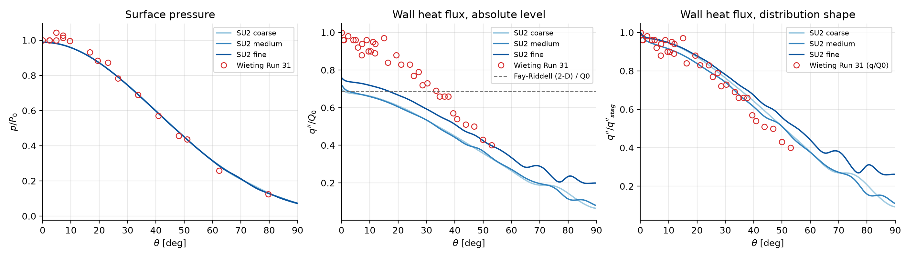
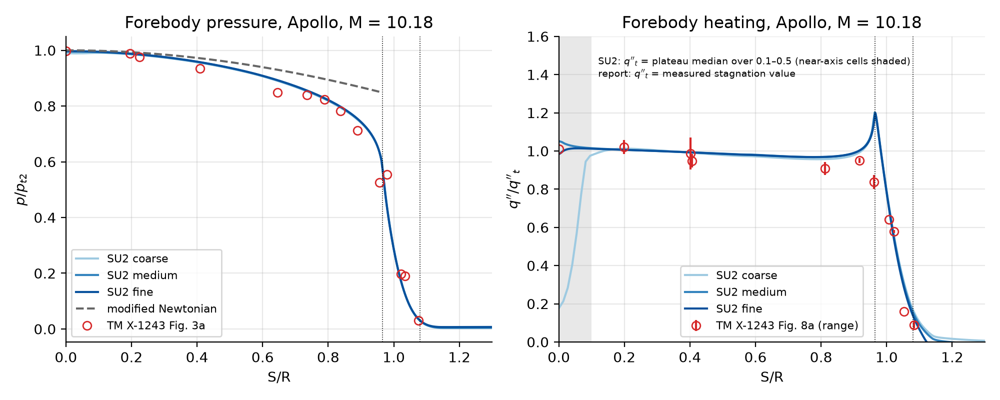

# Verification and validation

*Project AETHER. Sections A.2–A.4 record the numerical investigation of 24 June – 2 July 2026 (exploratory runs on the coarse meshes; not part of the final case set). Sections A.1, B and C are filled from `results/results.csv` and the case directories.*

## A. Solver behaviour and settings

### A.1 Benchmark A — Wieting Run 31 cylinder (planar)

Configuration: laminar Navier–Stokes, M = 8.03, p∞ = 855 Pa, T∞ = 124.94 K, isothermal wall 294.44 K, SLAU2 with exact flux Jacobian, stage 1 first order, stage 2 MUSCL + Venkatakrishnan–Wang limiter; three nested polar meshes. Comparison quantities: normalised surface pressure p/P₀ (P₀ = 10.47 psia, the report's stagnation-line pressure) and heat flux q''/Q₀ (Q₀ = 63.49 Btu/ft²·s = 721 kW/m², the report's measured stagnation value) against the transcribed Run 31 table; absolute stagnation heat flux against Fay–Riddell (2-D, perfect gas: 487 kW/m²).

| Level | cells | C_D 1st / 2nd order | q''_stag 1st / 2nd [kW/m²] | q''_stag / Q₀ (report) | q''_stag / Fay–Riddell | p_stag / pitot | rms shape diff. q, p |
|---|---:|---:|---:|---:|---:|---:|---:|
| coarse | 23 380 | 0.6300 / 0.6275 | 499 / 504 | 0.70 | 1.02 | 1.000 | 0.046, 0.023 |
| medium | 52 290 | 0.6293 / 0.6273 | 516 / 520 | 0.72 | 1.05 | 1.000 | 0.037, 0.023 |
| fine | 117 180 | 0.6294 / 0.6278 | 555 / 548 | 0.76 | 1.11 | 0.999 | 0.062, 0.023 |

What the comparison supports: (i) the stagnation pressure equals the Rayleigh pitot value to 0.1 % and the pressure distribution follows the measurements to within their scatter (rms 0.023 in p/P₀ over 18 stations); (ii) the computed stagnation heat flux is 2–11 % above the perfect-gas Fay–Riddell value and 24–30 % below the report's measured Q₀ — the same gap the report itself notes between its measurements and viscous-shock-layer theory (18 % for the Mach 6.3 run) and that is commonly attributed to free-stream noise and the thermally perfect stagnation enthalpy of the shock tunnel; (iii) the normalised distribution q''/q''_stag follows the measured q''/Q₀ to rms 0.04–0.06 over 34 stations, with the computed profile decaying slightly more slowly than the measurements between 25° and 50°; (iv) the first- and second-order solutions differ by at most 1.3 % in stagnation heating and 0.4 % in drag, which bounds the order effect for the axisymmetric runs where only first order is used; (v) on the finest mesh the second-order limiter leaves small oscillations in the expansion beyond 60°, a region irrelevant to the heating objective. The absolute heating level is therefore not claimed to better than about 25 %; the ranking of shapes relies on the distribution shape and on differences at the same condition.

### A.2 Choice of the convective scheme (coarse cylinder, exploratory)

All runs: first-order, implicit Euler, from a uniform free stream.

| Scheme | Behaviour at 800–1500 iterations | Wall heat flux | Verdict |
|---|---|---|---|
| AUSM+-up2 | residual stalls at 10⁻²·⁷, bow shock kinked at 40–50° (carbuncle) | not meaningful | rejected |
| AUSM | same | — | rejected |
| Roe, entropy fix 0.1 | same | — | rejected |
| Roe, entropy fix 0.3 | converges to 10⁻⁶ in 490 iterations | stagnation 2.26 MW/m² (3 × experiment): the fix dissipates the boundary layer | rejected |
| JST (central) | converges to 10⁻⁷·⁹ | heating dip at the stagnation line (151 kW/m² at θ = 0, 494 at 13°): carbuncle in a converged solution | rejected |
| SLAU2 + exact Jacobian | residual plateau 10⁻³·⁴, drag and heating stationary to 10⁻⁴ | stagnation 546 kW/m², monotone decrease | **adopted** |
| MSW, SW (flux-vector splitting) | diverge | — | rejected |
| AUSM+M | aborts at start | — | rejected |

On the coarsest cylinder mesh the second-order stage changes the stagnation heat flux from 546 to 535 kW/m² (−2 %) and the drag coefficient from 0.632 to 0.628 (−0.6 %).

**Two steady branches and the start-up procedure (4–7 July).** Refining the mesh from a uniform free-stream start, the first-order SLAU2 solution locked into a carbuncle state on every body (C.1). Two observations resolved this: (i) restarting a carbuncle-free Roe-fix solution with the fix switched off (a source change that scales the fix by a pressure-jump sensor, kept in `tools/aether_su2_patches.diff`) stayed on the clean branch and re-converged to 10⁻¹⁰ — the clean solution is a stable steady state of the operator; (ii) restarting SLAU2 from the converged Roe-fix field converged to the clean branch on the refined cylinder (residual 10⁻⁸·⁷, monotone heating 502 kW/m²) and on the refined capsule (stagnation pressure 25.3 kPa, flat heating 98 → 90 kW/m², shoulder peak 113), where free-stream starts had failed. The Roe-fix solution itself is not usable for heating: its wall-node temperature sits 20–50 K above the imposed value and its heat flux is ×3 (the Roe linearisation with the fix dissipates the entropy wave across the strong density gradient of the boundary layer), which is why SLAU2 is restarted from it. Production procedure: stage 1 Roe (fix 0.3, CFL 0.5 → 10), stage 2 SLAU2 first order (CFL 1 → 30), stage 3 SLAU2 MUSCL for the planar benchmark only.

**CFL.** SU2's adaptive controller started below 1 collapses to its floor during the start-up transient and then crawls; a fixed CFL of 3 from a uniform free stream diverges; a Roe start-up with the cap at 30 can misbehave on the coarsest capsule mesh (stagnation pressure 17 kPa) while a cap of 10 converges. Adopted: adaptive control (factor 0.5 down, 1.2 up), 0.5 → 10 in stage 1 and 1 → 30 in stage 2.

### A.3 Axisymmetric near-axis treatment (SU2 defect and patch)

Test: the validated cylinder mesh and settings run with `AXISYMMETRIC = YES` (a sphere of 38.1 mm radius at the Run 31 condition). Expected: a smooth, monotone heat-flux distribution from the stagnation point; Fay–Riddell (axisymmetric) gives 652 kW/m².

| Solver build | q'' at wall nodes 0°, 1.1°, 2.3°, 3.4°, 5.6°, 9° [kW/m²] | Stagnation pressure, nodes 0–3 [kPa] |
|---|---|---|
| SU2 v8.5.0 release | 504, **154**, 246, 519, 643, 705 | 70.1, **68.5**, 69.7, 69.1 |
| SU2 v7.5.1 release | **70**, 121, 281, 551, 602, 638 | — |
| SU2 v8.5.0 + PR #2715 patch | 848, 829, 794, 770, 752, 708 | 70.8, 70.7, 70.7, 70.5 |

The defect (wrong pressure, temperature and heat flux in the two or three grid columns next to the axis, independent of flux scheme, gradient method, and of moving the symmetry line to y = 10⁻⁶–10⁻⁴ m) is the subject of SU2 issues #1373 and #2438. Pull request #2715 (open since 22 January 2026) replaces the singular 1/r source-term evaluation near the axis by an L'Hôpital-consistent form; its two source-file changes are applied to the v8.5.0 tree (`tools/pr2715.diff`) and the result is the project solver. With the patch the planar and axisymmetric solutions on the same mesh differ only by the physics (stagnation heating ratio sphere/cylinder = 1.55 on the coarse mesh; theory 1.34–1.41), the residual converges to 10⁻⁹·⁶, and the Apollo first-order solution reproduces the measured shape of the heating distribution (Section B).

### A.4 Second-order reconstruction in axisymmetric mode

With the patched solver, MUSCL reconstruction on the Apollo baseline (coarse mesh, truncated domain) does not reach a stationary state:

| Configuration (stage 2, restart from the converged first-order field) | Stagnation pressure range [kPa] (pitot 25.5) | Stagnation heat flux range [kW/m²] |
|---|---|---|
| SLAU2, Venkatakrishnan–Wang 0.05, CFL 1.5 fixed, 4500 it. | 22.8 – 32.7 | 220 – 518 |
| same, limiter frozen after restart | 26.8 – 31.5 | 376 – 518 |
| same, CFL 1.0 | 22.8 – 27.5 | 221 – 350 |
| AUSM+-up2 | 22.7 – 39.6 | 32 – 805 |
| AUSM | 20.8 – 27.6 | −207 – 310 |
| HLLC | 26.7 – 148 | 158 – 5484 |
| **same configuration, AXISYMMETRIC = NO (planar)** | 25.7 – 26.2 | 93 – 106 |
| **first-order SLAU2, axisymmetric** | 25.27 (stationary) | 99.5 (stationary) |

Also tried: Venkatakrishnan (0.05), Venkatakrishnan–Wang 0.3, Barth–Jespersen, van Albada, adaptive CFL, weighted-least-squares reconstruction, Euler-wall axis, coarser and finer shock-normal spacing — none stationary. Since the planar solution is stationary with the same settings and the first-order axisymmetric solution converges, the non-stationarity is attributed to the interaction of SU2's axisymmetric formulation with the reconstruction, not to the physics or the mesh. **Decision:** the axisymmetric production runs use first-order SLAU2. The discretisation error is quantified by the three-level mesh study (observed order and Richardson extrapolation, Section C) and the first/second-order difference is reported on the cylinder benchmark (A.1), where both are stable. This is a stated limitation of the study.

### A.5 Heat-flux evaluation and convergence criteria

- Wall heat flux and pressure are taken at the wall nodes of the volume solution (`aether/vtkio.py`), cross-checked against −k ΔT/Δn from the first cell (agreement within 3 %). SU2's history field MAXIMUM_HEATFLUX is not the nodal maximum (serial check: 723 vs 546 kW/m²) and is used only as a stationarity monitor.
- Sign convention: SU2's `Heat_Flux` is positive into the wall; negative values occur only on the cold expanded flow over the cone where the 300 K wall heats the gas.
- A case is "converged" when (i) the Cauchy criterion of SU2 on drag and the heat-flux monitor (relative change < 2 × 10⁻⁵ over 500 iterations) stops the run or the iteration limit is reached, (ii) the post-processor finds drag flat to 0.2 % over the last 500 iterations, the density residual reduced by at least one order and the heating objective changed by less than 3 % between the last two solution snapshots (the observed change enters the trade-space uncertainty; SU2's global heat-flux monitor is not used because it includes the near-axis cells), and (iii) the solution passes the physical-branch check below. Cases failing (ii) are kept in `results.csv` with status `not_converged`.
- **Physical-branch check.** A converged solution on the carbuncle branch is recognisable by physics alone: its stagnation pressure exceeds the Rayleigh pitot value (by 8 % on the baseline coarse mesh; a steady inviscid flow cannot exceed it), and its stagnation-line heating exceeds the shield plateau by a factor 3–5 while the measured distribution is flat. The post-processor rejects any solution with p_stag/p_t2 > 1.03 (status `carbuncle_branch`). The run driver then repeats stage 2 from the same stage-1 state with up to three alternative CFL schedules (fixed 1.0; adaptive 1 → 30; adaptive 0.5 → 5); every attempt's history and log are kept. A case that fails all attempts stays in `results.csv` as unresolved and is excluded from the trade space; the number of retries per case is reported.
- **Low-CFL retries are transients, not solutions.** A sweep case whose SLAU2 stage reaches the physical branch only through a retry at low CFL is reported but not ranked (status `unresolved_retry`). The first evidence (S08, 13 July) was that the low-CFL solution has a stagnation-region plateau of 78 kW/m² against 90 for the adaptive-CFL (carbuncle-branch) solution of the same case, and that neither state converts into the other within 4000 iterations. The decisive evidence came from physics (14 July): S03 and S08 share the baseline nose radius and so should share its plateau of 92 kW/m², but their low-CFL solutions give 76 and 79; N10 has a smaller nose radius and should sit above the baseline, but gives 91. In pseudo-time, 4000 iterations at CFL 0.5–1 are worth 70–130 iterations of the schedule on which the clean cases needed 1400 to converge, so these runs met the Cauchy criterion only because nothing moves fast at low CFL: the "physical branch" of a low-CFL retry is a slow transient. Such values are listed in `results/results.csv` with their attempt history and never enter the trade space; the family-B solutions of the same shapes (A.6) are 8–15 % higher in the heating objective.
- **Near-axis cells.** On the physical branch the wall nodes next to the axis may still carry a residue of the axisymmetric axis treatment that the patch of A.3 reduces but does not remove on every mesh: on the coarse and fine baseline meshes a bump of up to +80 % at the axis decaying to the plateau by S/R ≈ 0.2, oscillating by tens of percent between snapshots, while on the medium mesh the axis cells sit within 3 % of the plateau and the plateau (0.1 ≤ S/R ≤ 0.5), the shoulder peak and the drag are stationary to 0.1 % on every level. The heating objective is therefore defined as the larger of the plateau median and the maximum over the outer shield 0.25 ≤ S/R ≤ S/R(P₂); where the axis is clean the face is flat and this equals the shield maximum within 2 %, and for the smallest nose radius in the sweep (R_n/D = 0.6, a sphere-like cap) the plateau median underestimates the true stagnation maximum by about 3 %. Every case reports whether its axis region is clean (within ±25 % of the plateau) and its near-axis minimum and maximum; the mesh study uses the plateau and the shoulder peak, which are unaffected.

### A.6 The carbuncle branch is a property of the mesh: solution sequencing and the second mesh family

On the first mesh family (A, isotropic cells in the shock region) eight of the eighteen valid sweep shapes ended on the carbuncle branch at every stage-2 attempt (S03, S08, N10, K01–K05), while the baseline at all three levels and the other ten shapes converged cleanly with the same procedure. To separate the start-up transient from the mesh, the converged medium-level baseline solution was interpolated onto the S08 mesh (`aether/restart.py`, `python -m aether reinit`; linear interpolation on the source triangulation, 1942 of 118 974 target points outside the source hull filled by nearest values) and SLAU2 restarted from it with the standard schedule. The run converged in 500 iterations with the density residual down seven orders, to the carbuncle branch: stagnation pressure 12 % above the pitot value, stagnation-line heating 7 × the plateau, and a plateau of 92.7 kW/m² that is itself consistent with the baseline. Starting on the physical branch of a neighbouring shape therefore does not help: on these meshes the carbuncle state is the only steady state of the first-order scheme, and the branch is decided by the mesh, not by the history.

The carbuncle is the shock-aligned instability of upwind fluxes; it is strongest when the cells along the shock are as small as the cells across it and is suppressed by elongating the cells along the shock (Quirk 1994; Pandolfi and D'Ambrosio 2001; Kitamura et al. 2010). The family-A cells in the shock region ahead of the cap are 0.53 × 0.53 mm at the sweep level. Family B (docs/mesh.md) keeps every spacing except the cap wall spacing, which is raised to 1.5 × the shock-normal spacing, giving cells of aspect ratio about 1.5 along the shock. Tests on the two most important unresolved shapes:

| Case | Family A, low-CFL retry (not ranked) | Family A, carbuncle branch | Family B, first attempt |
|---|---:|---:|---:|
| S08: plateau / shoulder peak [kW/m²]; p_stag/p_t2; residual drop; iterations | 78.9 / 92.5; 1.000; 2.5; 3963 | 92.7 / 109.0; 1.124; 7.0; 500 | 92.2 / 108.5; 0.996; 2.9; 4000 |
| N10: plateau / shoulder peak [kW/m²]; p_stag/p_t2; residual drop; iterations | 90.8 / 96.1; 0.996; 2.4; 4000 | 93.7 / 104.3; 1.095; 3.3; 829 | 97.7 / 104.7; 0.996; 3.5; 1437 |
| B00 (baseline nose radius, for reference): plateau / peak | 91.9 / 110.7 (family A, medium) | — | 91.9 / 106.7 (family B, medium) |

Both family-B solutions are on the physical branch at the first attempt with the convergence behaviour of the clean family-A cases, and their plateaus are where physics puts them (S08 equal to the baseline, N10 above it). Family B was therefore adopted as the production family for the whole sweep, the baseline levels and the far-boundary check (results in C.2 and in the report); family A remains in the repository as an independent cross-check for the shapes converged on both families (results/tables.md, "mesh-family cross-check").

## B. Benchmark B — Apollo at α = 0 (axisymmetric)

Configuration: main condition (docs/conditions.md), baseline geometry, first-order SLAU2 (A.4), three nested meshes of the production family B and, for cross-check, the two clean levels of family A (A.6, docs/mesh.md), truncated domain. Comparisons: p/p_t2 vs S/R against TM X-1243 Fig. 3a; q''/q''_t vs S/R against Fig. 8a (range of data), with q''_t the computed plateau value; stagnation pressure against the Rayleigh pitot value; stagnation heat flux against Fay–Riddell; drag coefficient against the integral of the measured forebody pressure and against modified Newtonian theory.

| Family / level | cells | C_D (SU2) | C_D (surface integration) | p_stag / pitot | q'' plateau [kW/m²] | plateau / Fay–Riddell | shoulder peak [kW/m²] | stand-off / D | rms diff. p/p_t (14 stations) | rms diff. q/q_t (11 stations) |
|---|---:|---:|---:|---:|---:|---:|---:|---:|---:|---:|
| B coarse | 43 680 | 1.4612 | 1.4609 | 0.989 | 93.8 | 1.11 | 112.8 | 0.154 | 0.050 | 0.279 (axis cells, A.5) |
| B medium (sweep level) | 97 500 | 1.4627 | 1.4622 | 0.996 | 91.9 | 1.09 | 110.6 | 0.152 | 0.051 | 0.118 |
| B fine | 219 375 | 1.4605 | 1.4596 | 0.997 | 91.2 | 1.08 | 109.3 | 0.151 | 0.052 | 0.111 |
| A coarse | 49 056 | 1.4620 | 1.4619 | 1.001 | 90.5 | 1.07 | 113.4 | 0.154 | 0.050 | 0.198 (axis cells oscillating) |
| A medium | 109 500 | 1.4628 | 1.4623 | 0.995 | 91.9 | 1.09 | 110.7 | 0.152 | 0.051 | 0.119 |
| A fine (physical branch reached only after three retries, not used) | 246 375 | 1.4615 | — | 0.998 | 90.6 | 1.07 | 105.8 | 0.151 | — | — |

What the comparison supports. **Families:** on the two levels where both families are on the physical branch, drag agrees to 0.01 % and the shoulder peak to 0.2–0.5 %, the plateau to 0.1 % (medium); the coarse levels differ in the near-axis residue only. **Pressure:** the stagnation pressure equals the pitot value within 0.5 % (1.1 % on the coarse level); over the spherical cap the computed p/p_t follows the measurements to an rms of 0.05 with the largest differences at the two stations on the toroid (S/R = 0.956 and 0.98, where the measured pressure falls earlier than computed, +0.11 and −0.12), i.e. the measured expansion around the shoulder starts slightly before the geometric tangency. Modified Newtonian theory (dashed) overestimates the pressure beyond S/R ≈ 0.3, as the report itself notes. **Drag:** the SU2 force integration and the independent integration of the wall pressure and skin friction from the surface data agree to 0.03 %, which verifies the axisymmetric force normalisation (2π y weighting) used for every candidate; modified Newtonian theory gives a forebody C_D of 1.59 against 1.46 computed, the difference being its known overestimate over the outer face. **Heating:** the computed distribution is flat over the face (q/q_t between 0.97 and 1.04 for S/R ≤ 0.92 on the medium mesh), as measured; the plateau level is 8–11 % above the perfect-gas Fay–Riddell estimate for the baseline nose radius, consistent with the report's remark that measured stagnation velocity gradients exceed the Newtonian value by about 12 %. The one systematic difference is the shoulder: SU2 gives a sharp peak of 1.18–1.23 q_t at the cap/toroid tangency where the measurements show 0.80–0.87, then both fall together (0.71 vs 0.64 at S/R = 1.007; 0.15 vs 0.07–0.11 at 1.083). A thin-skin thermocouple cannot resolve a peak narrower than its lateral conduction length on a 0.35-inch toroid, and Lees' laminar theory applied to the measured pressures (the report's own curve) also peaks at the tangency, so the peak is treated as physical but its height as uncertain; it is the quantity that defines the heating objective for most candidates, and the mesh study (C.2) bounds its numerical uncertainty. **Shock stand-off:** 0.152 D on the axis, between the sphere correlation of Billig (0.18 D for R_n) and the flat-disc value, as expected for a cap of R_n/D = 1.2.

## C. Mesh convergence and domain check

### C.1 Refinement of the shock region (exploratory, 4 July 2026)

Refining every spacing by 1.5 from the base level re-triggers the stagnation-line instability of the first-order solution, independently of the flux function:

| Case (first order, patched solver) | Result at the stagnation line |
|---|---|
| Cylinder, all spacings ÷ 1.5, SLAU2 (two stages) | heat flux 932 kW/m² at θ = 0 against 460–470 at 9–18°, residual plateau 10⁻³·⁸ |
| Cylinder, tangential ÷ 1.5 only, SLAU2 | 754 kW/m² at θ = 0 decaying to 609 at 6° (bump of +24 %) |
| Cylinder, boundary layer ÷ 1.5 only, SLAU2 | 546 → 532 → 521 → 514 … kW/m² (smooth, Lees-like) |
| Cylinder, all spacings ÷ 1.5, AUSM+-up2 (Kp 0.25) | 1134 kW/m² at θ = 0, 464 at 9° |
| Cylinder, same, AUSM+-up2 with Kp = 1.0 and 3.0 | diverge |
| Capsule, all spacings ÷ 1.5, SLAU2 | stagnation pressure 29–32 kPa (pitot 25.5), heating spike 360–560 kW/m² |
| Capsule, same, Roe with entropy fix 0.05 | stagnation pressure 51 kPa |
| Capsule, boundary layer ÷ 1.5 only, SLAU2 | stagnation pressure 25.4 kPa; near-axis bump +40 % within s/R < 0.05; plateau (s/R = 0.3) 93 vs 94 kW/m², shoulder peak 113 vs 115 |
| Capsule, boundary layer ÷ 2.25 only, SLAU2 (gentle start) | converged; see results table |

The boundary-layer-only family was adopted provisionally on 5 July, then abandoned on 7 July when the base-level capsule itself locked into the carbuncle branch after a change of the far-field stretching only: the branch selection is a property of the start-up transient, not of the mesh (A.2). With the Roe-fix start-up the fully refined levels converge to the clean branch (cylinder 502 and 520 kW/m² at ÷1.5 and ÷2.25; capsule 25.3 kPa, 98 kW/m²), and the production family refines every spacing (docs/mesh.md). The coarsest 1.2 mm capsule mesh still locks into the carbuncle branch even with the start-up procedure and is not used; the family starts at 0.8 mm.

### C.2 Richardson extrapolation, GCI and domain check (family B)

Three nested levels (r = 1.5 in every spacing) of the production family, Richardson extrapolation and GCI after Celik et al. (2008), computed by `python -m aether uncertainty` (`results/uncertainty.json`, `docs/mesh_convergence.md`). The observed order is used with Fs = 1.25 only when the triplet converges monotonically with shrinking differences; an oscillatory triplet gets p = 1 and Fs = 3.

| Quantity | coarse | medium | fine | observed order p | extrapolated | GCI fine | GCI medium |
|---|---:|---:|---:|---:|---:|---:|---:|
| C_D | 1.4612 | 1.4627 | 1.4605 | n/a (oscillatory, range 0.15 %) | n/a | 0.89 % | 0.60 % |
| q''_max shield (objective = shoulder peak) [kW/m²] | 112.8 | 110.6 | 109.3 | 1.49 | 107.8 | 1.7 % | 3.1 % |
| q'' plateau median, 0.1 ≤ S/R ≤ 0.5 [kW/m²] | 93.8 | 91.9 | 91.2 | 2.36 | 90.8 | 0.6 % | 1.6 % |
| shock stand-off / D | 0.1540 | 0.1524 | 0.1514 | 0.94 | 0.149 | 1.9 % | 2.7 % |

The heating objective converges at close to the formal first order of the convective scheme (p = 1.5; the diffusive terms are second order) and its medium-level value is 2.6 % above the extrapolated one. On family A the same triplet was not in the asymptotic range (113.4, 110.7, 105.8 kW/m²: differences growing with refinement, p = −1.5, GCI with p = 1 and Fs = 3 of 14 %), which with hindsight is explained by its fine level having reached the physical branch only through low-CFL retries (A.5): the family-A fine value is not a converged solution and is not used. Drag is converged to 0.15 % across the levels on both families.

**Domain check (medium level).** `cases/variant/B00_base_far_t15` repeats the medium-level baseline with the far boundary at 3.0 D ahead of the nose and 7.0 D downstream (2.0 D / 4.5 D in production): C_D 1.4625 against 1.4627 (0.01 %), peak heating 110.5 against 110.6 kW/m² (0.05 %); both changes are far below the mesh uncertainty, so the production domain is accepted.

**Uncertainties used in the trade space** (results/uncertainty.json): the absolute uncertainty of a medium-level value is the largest of the medium-level GCI, the far-boundary sensitivity and the largest residual non-stationarity among the converged sweep cases: u_CD = 0.6 %, u_q = 3.1 %. The uncertainty of a *difference* between two designs computed on the same family is smaller than the absolute one; it is measured directly by re-running the finalists at the fine level and comparing their ratios to the baseline between the two levels (C.3), and those margins are the ones used to decide whether two designs differ.

### C.3 Ranking stability of the finalists (fine level)

Finalists: the selections of the three rules (N10 for 98 % and 95 %, C41 for 100 %), the highest-drag shape (S03, family C) and the lowest-heating shape (K03), re-run at the fine level of their own family (`python -m aether refine --levels fine`). Ratios are formed against the baseline of the same family and level, so a change of ratio between levels measures the discretisation error of the *difference*, which is what the ranking depends on.

| Case | C_D medium → fine | q''_max medium → fine [kW/m²] | C_D / C_D,B00 medium → fine | q''_max / q''_max,B00 medium → fine |
|---|---:|---:|---:|---:|
| N10 | 1.4366 → 1.4380 | 104.7 → 103.5 | 0.9822 → 0.9846 | 0.9471 → 0.9471 |
| C41 | 1.4644 → 1.4626 | 110.2 → 109.4 | 1.0012 → 1.0014 | 0.9965 → 1.0004 |
| S03 (family C) | 1.5039 → 1.5044 | 113.3 → 110.9 | 1.0282 → 1.0301 | 1.0293 → 1.0149 |
| K03 | 1.3262 → 1.3274 | 102.9 → 102.1 | 0.9067 → 0.9088 | 0.9307 → 0.9341 |

Every finalist converged at the first SLAU2 attempt at the fine level (the Roe start-up needed its lower CFL cap for C41 and K03). The largest change of a ratio is 0.24 % in drag (N10) and 1.4 % in peak heating (S03, whose sharp shoulder peak is the least converged quantity of the study); with the far-boundary sensitivity, the residual non-stationarity and the family-C baseline offset these give the ranking margins u_CD = 0.24 % and u_q = 1.4 % used for the robust nondominated set (results/uncertainty.json). The nondominated set {S03, C41, N10, K03} is the same at both levels.
